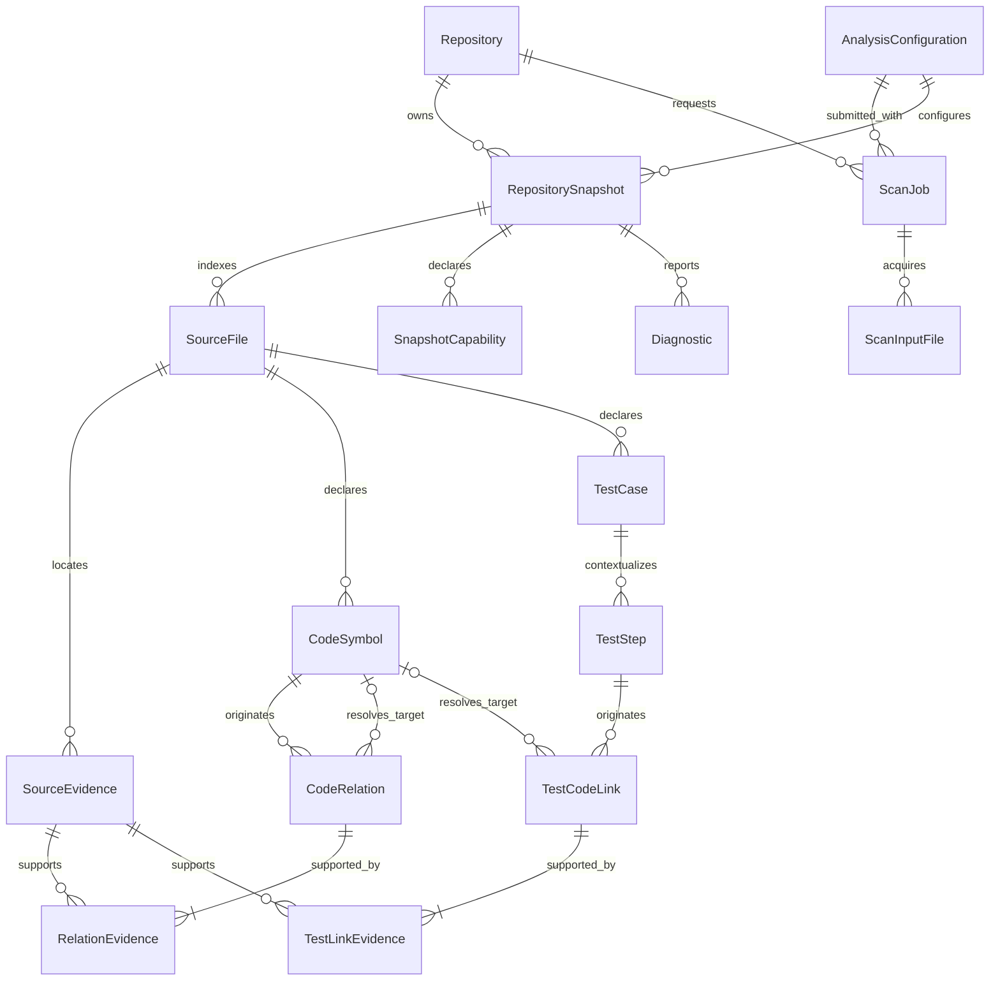
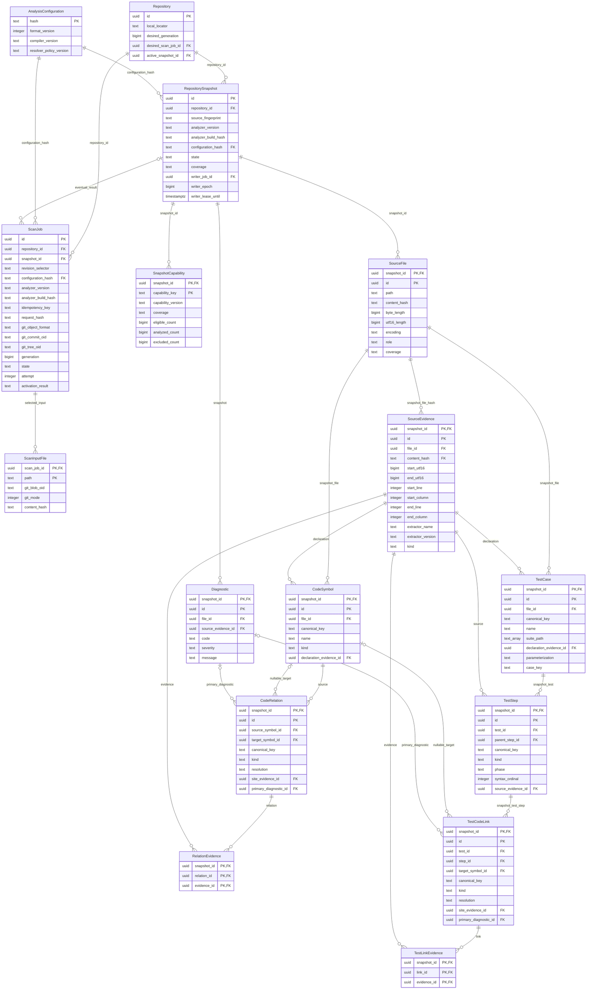

# CodeThread architecture and DB-01 design

This document defines the Foundation and proposed database design for the local,
single-developer V0. It is a logical design, not evidence that PostgreSQL
enforces these rules. Production migrations and persistence behavior start only
after DB-01 approval. Requirement lifecycle is not execution status.

## 1. Product and ownership

The investigation flow is repository revision → source file/module/symbol or
supported entry point → supported relationships → related declarations → exact
source and provenance. No test is required. Optional test analysis adds
behavior, setup/actions/mocks/conditions/assertions and code-to-test navigation.
Linear and graphical views consume the same projection. Independent evaluation
compares IDE baseline, textual trace and an information-equivalent visual trace.
No comprehension benefit is claimed by implementation tests.

Current packages:

| Owner               | Behavior                                                                                                                            | Dependencies                                                     |
| ------------------- | ----------------------------------------------------------------------------------------------------------------------------------- | ---------------------------------------------------------------- |
| code-model          | Source ranges, analysis identity components, evidence and resolution validation, semantic projection primitives                     | Zod only; no filesystem, database, UI, Jest or NestJS dependency |
| contracts           | Runtime-validated read requests/projections, scoped cursors, bounds, trace reference validation                                     | code-model and Zod                                               |
| symbol-indexer      | Bounded manifest validation, isolated TypeScript extraction and retained source                                                     | code-model, pinned TypeScript and explicitly allowed Node APIs   |
| trace-engine        | Source-verified, bounded in-memory graph exploration                                                                                | code-model, contracts and Node crypto; no compiler or filesystem |
| Application scripts | Explicit local Git object acquisition, CLI orchestration and bounded loopback viewer presentation; no extraction or graph traversal | symbol-indexer, trace-engine, code-model/contracts and Node      |
| Foundation scripts  | Requirements and package-boundary verification                                                                                      | Node, TypeScript API, YAML and Ajv                               |

Data flows from source ingestion/semantic extraction → code model →
tracing/query behavior → transport/presentation. Code dependencies point from
consumers toward the framework-independent model; the model never imports its
extractors. Future code dependency direction is transport → application
orchestration → semantic modules. Symbol/test indexers produce code-model facts;
trace-engine consumes facts, not framework AST internals. Database owns
adapters, not semantic rules. `scripts/git-source.ts` owns Git object
acquisition; `scripts/investigate.ts` owns arguments, source selection display
and session orchestration. API uses contracts rather than exposing Drizzle rows.
UI uses contracts/API rather than the database. No Next.js backend duplicates
Fastify/application rules.

`arch:check` checks source imports/re-exports, literal dynamic imports,
import-type references, declared dependencies, package cycles and public-root
imports. It rejects CommonJS and nonliteral dynamic imports in these packages.
Its explicit ownership allowlist must change deliberately when real modules are
introduced. It is a source architecture guard, not a sandbox for running
analyzed repositories.

### Module organization and staged size checks

The public package root and existing command entry points remain stable while
implementation files are divided by their owning behavior. Internal modules
import their direct dependencies, with no source import cycles. Contracts keep
`schemas.ts` and `results.ts` as explicit compatibility facades; implementation
modules do not import those facades or `index.ts`.

| Contracts owner                           | Responsibility                                                                                |
| ----------------------------------------- | --------------------------------------------------------------------------------------------- |
| `query-common.ts`                         | Cursor encoding/scope, page fields, metadata, response snapshot scope and typed query errors. |
| `graph-queries.ts` / `graph-results.ts`   | Intrinsic graph schemas and request-aware neighbor/path validation.                           |
| `test-queries.ts` / `test-results.ts`     | Optional test queries, nested test links, supporting context and trace limits.                |
| `source-queries.ts` / `source-results.ts` | Evidence batches and diagnostic pages, including request correspondence.                      |
| `integrity.ts` / `graph-integrity.ts`     | Shared identity, location, declaration, evidence and graph integrity checks.                  |
| `result-common.ts`                        | Shared request-aware snapshot, applied-limit and page-advancement checks.                     |

Intrinsic schemas own structural validation; named result parsers own checks
against the original request. Every rule has one implementation. Shared helpers
remain with their semantic owner and are reused only when their meaning and
trust boundary agree. No new package or public export is needed for this split.

| Trace-engine owner                             | Responsibility                                                                                                                                |
| ---------------------------------------------- | --------------------------------------------------------------------------------------------------------------------------------------------- |
| `index.ts`                                     | Stable public `createInvestigation()` and `TraceError` exports; bind operations to one context.                                               |
| `context.ts`                                   | Clone/validate/freeze facts once, bind the retained-source reader, build source-ordered dictionaries and incoming/outgoing adjacency indexes. |
| `projection.ts`                                | Admit complete graph units within node/relationship/evidence/diagnostic budgets, order output and construct coverage/truncation metadata.     |
| `traversal.ts`                                 | Neighbor breadth-first search and bounded simple directed paths, preserving relation-kind filters, parallel occurrences and search budgets.   |
| `evidence.ts`                                  | Bounded evidence requests, retained-source comparison and typed unavailability results.                                                       |
| `validation.ts`                                | Snapshot identity, collection bounds/uniqueness, validation ordering and call-observation/count consistency.                                  |
| `source-validation.ts` / `graph-validation.ts` | Verified raw bytes, hashes, encoding and coordinates; declaration/diagnostic/relation integrity respectively.                                 |
| `fact-integrity.ts`                            | Trace error identity and the shared fact assertions for uniqueness and exact range equality.                                                  |

Each investigation owns its verified context; each operation allocates its own
projection and traversal budgets. Unknown targets never become adjacency. Path
node limits continue to count explored nodes, including dead ends; a bounded
negative result exposes truncation rather than claiming exhaustive absence.
Graph output still includes complete endpoints and evidence. `CALLS` remains the
default, and `REFERENCES` requires explicit selection. This organization changes
neither extraction nor semantic identities. Internal trace modules import their
owners directly rather than routing through `index.ts`.

ESLint enforces 500 physical lines per production file and 150 per function in
contracts and trace-engine, plus 700 per file for their contract, semantic-trace
and architecture/tooling tests. These modules require no size exceptions. Blank
lines and comments count; test suite callbacks have no function-size cap. Prefer
cohesive modules around 200-350 lines. Other owners acquire the same checks when
their refactor is integrated, preserving separate feature branches. An exception
must document its owner, reason, baseline SHA and maximum in the reviewed
configuration. Increasing a maximum requires explicit justification; remove
exceptions as their modules are cleaned. Compacting code or exporting unrelated
helpers does not establish maintainability.

`arch:check` checks internal source cycles in addition to package cycles and
rejects contracts and trace-engine implementation imports through compatibility
facades. It continues to inspect imports, re-exports, import types and literal
dynamic imports using the TypeScript AST. Application and browser dependency
checks expand with their owning refactor; these core stages do not claim those
later guards are active.

Refactor integration remains sequential: contracts, trace-engine, then
symbol-indexer, with each subsequent PR based on the integrated `main` it needs.
CT-COMP-001 now owns the bounded Git repository planner and session
orchestration; study organization requires the integrated PR #21 scoring
corrections. Do not rewrite those feature branches or create an implicit
refactor stack. Test-suite splits follow the corresponding application owner
rather than moving assertions into shared setup files.

## 2. Canonical language

**Repository:** a locally registered Git source lineage, with an identity that
does not change when its location moves. A matching remote URL alone does not
merge two registrations automatically.

**Source revision:** the resolved immutable Git commit and tree. Branch names
are input selectors, never durable snapshot identities.

**Analysis identity:** repository + source fingerprint + analyzer
version/build + canonical analysis configuration hash. Two configurations at one
commit can produce different indexed snapshots.

**RepositorySnapshot:** one indexed analysis result, mutable only while staging.
Published snapshots remain readable historically even when inactive.

**ScanJob:** one idempotent request and its operational progress. It is separate
from the shared analysis result that multiple requests may reuse.

**Exact resolution:** a source-level semantic target established by a supported
extractor. It does not prove a runtime call. An unresolved site is retained as a
site with diagnostics, not converted into an exact edge.

**SourceEvidence:** a typed, extractor-attributed span in immutable source
bytes. It supports a fact without proving the fact executed.

**Coverage:** complete, partial, not_analyzed or unsupported relative to a
versioned declared capability and source scope. Complete does not mean all
language behavior is known.

**TestStep:** syntax/semantic information attached to one test, including
contextual hooks. Its phase and syntax ordinal do not establish runtime order.

## 3. Conceptual and logical models

RepositorySnapshot, SourceFile, CodeSymbol, CodeRelation, SourceEvidence and
Diagnostic form the code-comprehension core. TestCase/TestStep/TestCodeLink are
an optional extension. Existing test-oriented read projections remain reusable;
they are not the sole future investigation API. The logical database proposal
remains unimplemented and must be reviewed against the semantic proof before
DB-02.

The database/API readiness review and operation inventory are linked from the
[README](../README.md). They distinguish logical proposals, executable in-memory
behavior and actual local HTTP routes.



SnapshotCapability is a capability/coverage association, not a status lookup
table. Its real purpose is to distinguish complete test extraction from, for
example, partial semantic linking in the same snapshot. Minimum-one support
multiplicities are publication invariants; foreign keys alone do not establish a
nonempty join.



### Data dictionary and cardinalities

All graph/test/evidence identifiers are opaque application-assigned UUIDs. Their
composite `(snapshot_id, id)` key establishes scope. Content/canonical keys
provide logical uniqueness; a UUID alone does not establish semantic identity.
Timestamps are UTC `timestamptz`; API locations are integers within JavaScript's
safe range. SQL `bigint` generation counters are never transported as unsafe
JSON numbers.

| Entity / owner                                | Required data and uniqueness                                                                                                                                                                                                                                                                                                                                                                                                                                                                                                                                                                                       | Nullable data / deletion                                                                                                                                                                                                                                                                                                                                                                                                                                                                                                                                                                                                                                                           |
| --------------------------------------------- | ------------------------------------------------------------------------------------------------------------------------------------------------------------------------------------------------------------------------------------------------------------------------------------------------------------------------------------------------------------------------------------------------------------------------------------------------------------------------------------------------------------------------------------------------------------------------------------------------------------------ | ---------------------------------------------------------------------------------------------------------------------------------------------------------------------------------------------------------------------------------------------------------------------------------------------------------------------------------------------------------------------------------------------------------------------------------------------------------------------------------------------------------------------------------------------------------------------------------------------------------------------------------------------------------------------------------- |
| Repository / source lifecycle                 | UUID; locator; generation ≥ 0; timestamps. One registered lineage owns many snapshots/jobs.                                                                                                                                                                                                                                                                                                                                                                                                                                                                                                                        | Desired job and active snapshot are nullable; each must belong to this repository. Moving the locator preserves identity. Repository deletion is explicit maintenance, never a query side effect.                                                                                                                                                                                                                                                                                                                                                                                                                                                                                  |
| AnalysisConfiguration / indexing lifecycle    | Lowercase SHA-256 PK; format/compiler/resolver versions; verified canonical configuration object in cache. It can be shared by snapshots.                                                                                                                                                                                                                                                                                                                                                                                                                                                                          | No mutable configuration payload. Referenced configurations and cache manifests are protected; unreferenced ones are maintenance candidates.                                                                                                                                                                                                                                                                                                                                                                                                                                                                                                                                       |
| RepositorySnapshot / indexing lifecycle       | Repository, source fingerprint, analyzer version/build digest, configuration hash, state, coverage, creation time. UNIQUE over repository + fingerprint + analyzer version/build + configuration hash; UNIQUE(repository_id, id) for scoped pointers.                                                                                                                                                                                                                                                                                                                                                              | Git acquisition provenance is not stored here: multiple scan jobs with different commits may reuse one semantic result. Publication time is absent in staging. Writer job/lease absent before ownership and after failed cleanup. Published payload freezes. Active/in-use snapshots cannot be purged.                                                                                                                                                                                                                                                                                                                                                                             |
| ScanJob / indexing lifecycle                  | Repository; the exact accepted caller revision selector; configuration hash; analyzer version/build pinned at request acceptance; nonempty bounded idempotency key; request hash; generation, state, attempt and timestamps. The request hash commits to repository identity, selector, UTF-8-byte-sorted selected paths and canonical configuration hash; it is distinct from semantic source fingerprint and snapshot identity. After resolution, retain Git object format and immutable commit/tree OIDs. UNIQUE(repository_id, idempotency_key), UNIQUE(repository_id, generation), UNIQUE(repository_id, id). | Selector, configuration and analyzer identity are immutable from request acceptance. Resolved Git identity is nullable until revision acquisition succeeds; result snapshot, terminal error code and activation outcome are nullable until available. Snapshot reference and effective analysis identity must match the repository/request. A failed job can retry only after a commit is pinned and only with the same request hash, commit and analyzer build. A failure before revision resolution has no immutable acquisition context and requires a new request/idempotency key. Retain jobs while needed for idempotency; explicit expiry is required before deleting keys. |
| ScanInputFile / source acquisition            | Scan job + exact case-preserved selected path PK; verified Git blob OID, regular file mode and raw source SHA-256. One row per admitted path, published only after the all-or-error selection succeeds.                                                                                                                                                                                                                                                                                                                                                                                                            | No partial selected-file provenance is stored for a failed acquisition. On successful result publication, transaction/application validation confirms each path and content hash matches the semantic snapshot manifest. Delete only with the owning request-retention policy.                                                                                                                                                                                                                                                                                                                                                                                                     |
| SnapshotCapability / indexing lifecycle       | Snapshot + capability key PK; capability version, coverage, nonnegative eligible/analyzed/excluded counts. analyzed + excluded ≤ eligible; completeness validated against the declared scope.                                                                                                                                                                                                                                                                                                                                                                                                                      | No nullable structural fields. Frozen with snapshot; deleted only during guarded whole-snapshot purge.                                                                                                                                                                                                                                                                                                                                                                                                                                                                                                                                                                             |
| SourceFile / source ingestion                 | Snapshot, file UUID, exact case-preserved source path, SHA-256 raw content hash, byte/UTF-16 lengths, UTF-8 encoding, source/test/declaration/config role and coverage. UNIQUE(snapshot_id, path COLLATE C); UNIQUE(snapshot_id, id, content_hash) supports evidence consistency.                                                                                                                                                                                                                                                                                                                                  | No Git OID or mode: these belong to ScanInputFile. Rows exist only for source accepted by strict UTF-8 validation; UTF-16 length is required. An INVALID_ENCODING analysis failure is recorded as a terminal ScanJob error and creates no semantic snapshot, SourceFile or SourceEvidence row. Content metadata is otherwise required. Whole-snapshot purge only.                                                                                                                                                                                                                                                                                                                  |
| SourceEvidence / extraction                   | Snapshot, UUID, file ID/content hash composite FK, half-open UTF-16 offsets, one-based coordinates, extractor name/version and static_source kind. Row bounds: 0 ≤ start ≤ end. File bounds and coordinate agreement checked against cache at publication.                                                                                                                                                                                                                                                                                                                                                         | No guessed source, nullable provenance or unverified content hash. Retained with the snapshot.                                                                                                                                                                                                                                                                                                                                                                                                                                                                                                                                                                                     |
| CodeSymbol / symbol-indexer                   | Snapshot, UUID, file ID, canonical key, display name/kind and declaration evidence. UNIQUE(snapshot_id, canonical_key). Range/path projections derive from the declaration evidence/file.                                                                                                                                                                                                                                                                                                                                                                                                                          | No unresolved placeholder symbols. Initial declarations have one authoritative evidence span; projection evidenceIds contains that span. Merged declarations requiring unsupported identity semantics remain diagnostic cases.                                                                                                                                                                                                                                                                                                                                                                                                                                                     |
| CodeRelation / trace-engine                   | Snapshot, UUID, source symbol, occurrence key, relation kind, resolution and call-site evidence. UNIQUE(snapshot_id, canonical_key), not source/target uniqueness. Evidence join contains the site and supporting records.                                                                                                                                                                                                                                                                                                                                                                                         | Target exists iff resolution=exact. Primary diagnostic required otherwise; exact rows have no primary diagnostic. Composite FKs scope all references.                                                                                                                                                                                                                                                                                                                                                                                                                                                                                                                              |
| RelationEvidence / trace-engine               | Snapshot + relation ID + evidence ID composite PK/FKs. One occurrence can have several supporting spans, one span can support several facts.                                                                                                                                                                                                                                                                                                                                                                                                                                                                       | No nullable endpoint or JSON evidence-ID list. Publication requires ≥ 1 row and the site attachment.                                                                                                                                                                                                                                                                                                                                                                                                                                                                                                                                                                               |
| TestCase / test-indexer                       | Snapshot, UUID, file ID, occurrence key, display name, suite path, declaration evidence and none/static/dynamic parameterization. UNIQUE(snapshot_id, canonical_key).                                                                                                                                                                                                                                                                                                                                                                                                                                              | case_key is null for an ordinary test or unresolved/template parameterization. Only safely extracted literal rows receive case keys; dynamic rows are never executed or invented.                                                                                                                                                                                                                                                                                                                                                                                                                                                                                                  |
| TestStep / test-indexer                       | Snapshot, UUID, test ID, occurrence key, source evidence, kind, phase, nonnegative syntax ordinal. UNIQUE(snapshot_id, test_id, id) and UNIQUE(snapshot_id, canonical_key).                                                                                                                                                                                                                                                                                                                                                                                                                                        | Parent step optional; FK(snapshot_id, test_id, parent_step_id) keeps containment inside one test. Publication checks containment cycles. Contextual hooks may share original evidence across tests without implying repeated execution.                                                                                                                                                                                                                                                                                                                                                                                                                                            |
| TestCodeLink / trace-engine                   | Snapshot, UUID, test/step ownership, occurrence key, kind, resolution and site evidence. FK(snapshot_id, test_id, step_id) references the step owner.                                                                                                                                                                                                                                                                                                                                                                                                                                                              | Target iff exact; primary diagnostic otherwise. No guessed production target. Several sites to the same symbol remain distinct.                                                                                                                                                                                                                                                                                                                                                                                                                                                                                                                                                    |
| TestLinkEvidence / trace-engine               | Snapshot + link ID + evidence ID PK/FKs, with site attachment required at publication.                                                                                                                                                                                                                                                                                                                                                                                                                                                                                                                             | Explicit typed join; no polymorphic reference that escapes a foreign key.                                                                                                                                                                                                                                                                                                                                                                                                                                                                                                                                                                                                          |
| Diagnostic / extractor or lifecycle validator | Snapshot, UUID, stable code, info/warning/error severity and bounded message.                                                                                                                                                                                                                                                                                                                                                                                                                                                                                                                                      | Optional file and evidence; evidence requires a file and must match it. Source-free repository diagnostics are allowed. No arbitrary cross-entity pointer or sensitive source payload in messages.                                                                                                                                                                                                                                                                                                                                                                                                                                                                                 |

Additional execution runs, runtime events, AI answers, embeddings and generic
artifact registries are deliberately absent. Core structural data is relational.
Optional JSONB may describe nonauthoritative extractor details; it cannot
replace identities, FKs, occurrences, provenance or required configuration
manifests.

Required same-file constraints supplement the snapshot keys: SourceEvidence has
UNIQUE(snapshot_id,id,file_id). CodeSymbol and TestCase declaration references
use FK(snapshot_id,declaration_evidence_id,file_id), and Diagnostic's optional
evidence uses the equivalent scoped file reference. A snapshot's writer job must
belong to its repository; a staging writer cannot borrow another repository's
job or epoch. Primary diagnostic references are scoped, while additional file
diagnostics are retrieved independently. Symbol/step evidence arrays include
their explicit primary declaration/source reference and may include auxiliary
evidence from other files. Primary anchors and call sites have file/range
checks; auxiliary evidence is not forced into the primary file. Relation/link
attachments are plural.

## 4. Identity, source and evidence conventions

The CT-SOURCE-001 CLI adapter resolves the selected revision to a full Git
commit ID once, then reads the commit, selected trees and selected blobs by
object ID using argument arrays and binary tree framing. It verifies each
object's declared type, size and Git object identity before retaining bytes, and
computes a separate raw-source SHA-256 for the existing manifest analyzer.
Checkout filters and hooks are not invoked. Submodules, symlinks, unsupported
tree modes and Git LFS pointer interpretation are unsupported; pointer-file
bytes, if explicitly selected as `.ts`, remain ordinary source bytes and are not
hydrated.

Git commit, tree, blob IDs and file modes are acquisition provenance, not inputs
to the existing manifest fingerprint. The adapter passes the same repository
UUID, selected POSIX paths, original bytes and raw SHA-256 hashes that a
caller-provided manifest would supply. Therefore, two commits with identical
selected paths and bytes have the same analyzer snapshot identity even if their
commits, trees, blob object formats or file modes differ. Changing a selected
path, byte, analyzer build or compiler configuration still changes the
applicable manifest-based identity. The proposed database model stores resolved
commit/tree identity and one `ScanInputFile` per admitted path under the
`ScanJob`; `RepositorySnapshot` and `SourceFile` retain semantic identity only.
Successful publication validates that the request's path/hash manifest matches
the shared analysis result. This lets distinct acquisitions reuse one snapshot
without conflating their provenance. Paths preserve case and Unicode exactly;
path matching uses raw UTF-8 component bytes without locale normalization.

AnalysisConfiguration's verified canonical cache document contains explicit
compiler/extractor versions, supported capability versions, effective compiler
options, include/exclude policy, resolver policy and resolution-input hashes.
Canonicalization recursively sorts object keys, preserves meaningful array
order, uses UTF-8 and rejects nonfinite/undefined values. Its format version is
explicit. The compiler's standard libraries belong to analyzer identity.
External declaration inputs must be retained/fingerprinted; ambient host
node_modules or current working-tree files cannot silently influence analysis.
Missing dependencies remain diagnosed unresolved inputs. Static indexing never
installs them automatically.

The in-memory proof accepts caller-supplied bytes, not a Git revision. Its
versioned source fingerprint hashes the UTF-8-byte-ordered path, raw SHA-256 and
byte length for each supplied file. Its configuration hash covers the explicit
fixed profile; its build fingerprint covers the analyzer, code model, compiler
and allowlisted library contents. A repository UUID and these components form a
deterministic proof snapshot UUID. Snapshot-local file/entity UUIDv8 values
derive from SHA-256 descriptors and duplicate identities fail validation. This
proof identity makes no commit/tree or published-database claim. The proposed
`ScanJob`/`ScanInputFile` provenance is a database acquisition record; it does
not alter the manifest fingerprint or deterministic semantic snapshot identity.

Snapshot-local canonical keys use a versioned kind plus SHA-256 of an anchor
descriptor. Symbols anchor to supported canonical declarations; test keys
include suite/declaration location and any static parameter case key.
Step/link/relation descriptors include their owning test/symbol, site span and
occurrence kind. Target/display-name changes are payload changes, not a reason
to collapse a site. A duplicate key with a different payload is an integrity
error; do not use silent ON CONFLICT DO NOTHING to conceal nondeterministic
extraction.

Raw source bytes are preserved, including BOM and CRLF. Decode UTF-8 strictly
and preserve the BOM in the decoded string. Positions follow the TypeScript line
map: zero-based UTF-16 offsets and half-open [start,end), with one-based
line/column. CRLF is one line break, and columns count UTF-16 code units, not
bytes or graphemes. The executable position validator is cross-checked against
TypeScript's API. Standalone range schemas validate shape; only content-aware
validation and hash verification establish agreement with a particular immutable
file.

`createSourcePositionIndex(source)` owns a private line-start array for one
immutable string. Callers control its lifetime: O(source length) construction,
O(line count) retained map and O(log line count) positioning. The returned
object is frozen and exposes no mutable map or global cache. Range validation
uses the same structural checks and two indexed lookups. Existing convenience
interfaces retain their behavior; bulk consumers should reuse a per-file index.
The opt-in `pnpm bench:positions` compares 3,000 lookups and 3,000 validations
on deterministic 100/6,000-line CRLF/Unicode inputs, including index
construction in the indexed total. It checks results against TypeScript outside
timing, warms 25 lookups, repeats three times and reports individual timings,
medians, dataset hashes, environment and Git state. Small/large synthetic
improvements justify the explicit indexed bulk API; no ingestion pipeline exists
here to measure. Raw measurements belong to review evidence, not fixed CI
budgets.

### Content-addressed cache

The cache root is outside analyzed checkouts and synchronized working folders by
default: the user's local application cache directory under CodeThread. An
explicit CODETHREAD_CACHE_DIR override must be an absolute private directory
with verified containment. No source cache is populated by Foundation.

Cache keys are SHA-256 digests, never caller-supplied paths. Store
source/config/ manifest objects under a private local cache root outside
database tables. A future ingestion adapter writes a temporary object inside
that root, verifies its raw hash/length, flushes and atomically renames on the
same filesystem. Reject symlink/reparse escapes; verify containment using
resolved paths. The original repository can subsequently move without
invalidating retained evidence.

Before publication, all required objects and the complete manifest must be
durable and verified. A crash before database commit may leave unreferenced
cache objects; it must not leave a published snapshot pointing to an unwritten
object. Source retrieval verifies the raw hash before decoding/slicing. Missing,
corrupted or unsupported content returns an explicit typed error, with no
working-tree fallback. Excerpt text contains exactly the evidence span, capped
at 65,536 UTF-16 units; larger spans return EVIDENCE_TOO_LARGE instead of silent
elision.

## 5. Integrity enforcement matrix

| Invariant / requirement               | SQL responsibility in DB-02                                                                     | Transaction/application responsibility and evidence                                                                                       |
| ------------------------------------- | ----------------------------------------------------------------------------------------------- | ----------------------------------------------------------------------------------------------------------------------------------------- |
| 1. Identity / CT-DB-001               | Analysis-tuple uniqueness; nonnull format/version/hash columns; request-scoped provenance keys  | Canonical manifests/configuration hashes; verify successful ScanJob inputs against the reused snapshot manifest; equivalent-input vectors |
| 2. Isolation / CT-DB-002              | Composite scoped FKs/keys for every owned reference; repository-scoped active/result pointers   | Response scope validation; negative writes and scoped query tests on real PostgreSQL                                                      |
| 3. Published immutability / CT-DB-003 | DML guards on snapshot children and referenced configuration; separate operational state        | Parent-row locking prevents validation/write races; negative INSERT/UPDATE/DELETE tests after publication                                 |
| 4. Atomic publication / CT-DB-004     | Published-state read predicates and transactional pointer update                                | Validate minimum evidence joins, coverage counts, source availability, ownership and cycles; concurrent reader/rollback tests             |
| 5. No fabrication / CT-DB-005         | CHECK exact iff target nonnull; unresolved primary diagnostic required; target and evidence FKs | Supported semantic resolver only; ambiguous/unsupported fixtures and false-positive evaluation                                            |
| 6. Occurrences / CT-DB-006            | Canonical occurrence uniqueness, never endpoint-pair uniqueness                                 | Two independent spans retained; identical-key/different-payload rejection                                                                 |
| 7. Evidence / CT-DB-007               | File/hash/snapshot composite FK, row bounds, nonnull extractor fields                           | Verify hash, UTF-8, full file bounds and coordinates; Unicode and corrupted-source cases                                                  |
| 8. Static/runtime / CT-DB-008         | Initial evidence kind is static_source; no runtime/pass fields                                  | Typed static projections; hooks/assertions/mocks described without execution claims                                                       |
| 9. Idempotency / CT-DB-009            | Repository/key uniqueness; one shared analysis tuple                                            | Canonical request comparison and explicit IDEMPOTENCY_CONFLICT; concurrent requests                                                       |
| 10. Stale activation / CT-DB-010      | Monotonic generation, scoped pointer FK and writer epoch                                        | Locked compare-and-swap; stale completion and fenced-writer tests                                                                         |

CHECK cannot enforce cross-table conditions, minimum join membership or
publication completeness. PostgreSQL's CHECK limitation and nullable-FK rules
are explicit in the
[PostgreSQL 18 constraint reference](https://www.postgresql.org/docs/18/ddl-constraints.html).
Use MATCH SIMPLE for nullable `(snapshot_id,target_id)` FKs: MATCH FULL would
reject the intentional nonnull snapshot/null target pair. A separate resolution
CHECK determines when the target is mandatory. Foreign keys do not automatically
index referencing columns; index choices require workload evidence.

## 6. Staging, concurrency and publication

Snapshot states are staging → published or staging → failed. An explicit fenced
retry may reset a failed unpublished result to staging. Published payloads never
return to staging. Inactive is a pointer relationship, not a mutable content
state. ScanJob states are requested, running, validating, succeeded, failed and
cancelled. Its separate activation_result is activated or superseded after
successful publication/reuse. A plain idempotent request returns the existing
job, including failures; explicit retry is a separate action. Only failed jobs
can restart, preserving generation/payload and incrementing attempt. Cancelled
jobs remain cancelled; a new intent requires a new key. Neither an old retry nor
a reused result can silently reclaim a superseded generation.

1. Canonicalize the submitted intent from repository identity, the exact
   validated caller revision selector, UTF-8-byte-sorted literal paths and the
   canonical configuration hash. In a short request transaction, lock
   Repository, look up the repository/key and compare `request_hash` before
   resolving a ref. An identical retry returns the existing job even if `HEAD`,
   a named ref or the installed analyzer build moved; changed caller payload
   reuse conflicts. The job retains the exact selector, configuration hash and
   effective analyzer version/build selected at acceptance. For a new key,
   increment `desired_generation` and create the desired job atomically. Its
   acquisition resolves the selector once and persists the immutable
   object-format/commit/tree identity immediately after resolution, before
   reading selected paths. It records all admitted per-file provenance before
   semantic publication. An acquisition failure records no partial file list. A
   failed job may be retried only if a commit was pinned; the retry verifies the
   same request hash and reuses that commit and analyzer build without resolving
   the selector again. If resolution itself failed, there is no immutable
   revision to retry, so a new request and idempotency key are required. A
   failed newer request does not silently restore older intent.
2. Find/create the unique analysis tuple. A published match can be reused
   without reindexing. A staging match has one writer_job_id, lease and
   monotonically increasing writer_epoch; other jobs wait for/reuse its result
   rather than write concurrently. No worker queue is required by this design.
3. Each bounded write batch locks the snapshot parent FOR SHARE, checks staging,
   writer identity, lease and supplied epoch, then writes transactionally.
   Parent mutation guards reject published children. Writer takeover obtains FOR
   UPDATE, advances the epoch, and atomically clears/restarts partial staging
   data before accepting another writer. Every old-token batch and publication
   must fail.
4. Publication locks Repository → Snapshot → ScanJob in that order. Write
   batches do not acquire repository locks while holding snapshot locks.
   Takeover, cancellation and maintenance follow the same ordering when both are
   needed. Under FOR UPDATE, validate all declared invariants and source
   readiness; lock exclusion prevents another child batch from changing the
   validated payload.
5. In the same transaction, mark the snapshot published and the job succeeded.
   Activate only if Repository.desired_generation equals this job's generation
   and its desired job still matches. Otherwise retain a valid inactive
   historical snapshot and mark activation superseded. Commit makes
   publication/pointer changes visible together. A waiting newer job referencing
   the same shared snapshot performs its own generation-checked activation.
6. Readers always resolve an active pointer once and carry the explicit snapshot
   ID throughout the request. Public queries reject staging/failed snapshots.
   Multi-query projections use a read-only READ COMMITTED transaction. First
   acquire a shared transaction advisory retention lock for the snapshot; only
   in the next SQL statement check published existence and read payloads.
   Immutability plus exclusive-purge exclusion keeps subsequent payload reads
   consistent. Hold the shared lock through bounded cache access, then
   commit/rollback; no reader lease table or session lock is needed. If purge
   won before the lock, the later existence check reports the missing snapshot
   instead of reading stale metadata.

FOR SHARE, rather than FOR KEY SHARE alone, prevents a non-key publication
update from racing a child write. Cross-row guards belong to reviewed SQL and
explicit transaction entry points, not application conventions alone. See
PostgreSQL's [locking](https://www.postgresql.org/docs/18/explicit-locking.html)
and [isolation](https://www.postgresql.org/docs/18/transaction-iso.html)
references.

Writer interruption leaves staging invisible. A retryable failed job reuses the
logical request, increments its attempt, claims a new epoch and restarts only
its staging result, using the already pinned commit and analyzer identity. A
failure before commit resolution cannot be retried under that job; a new request
key is required rather than resolving a moving selector under old intent. If
another request already published the shared analysis, reuse it. If the pinned
analyzer build is unavailable for retry, fail explicitly; never substitute the
current build. Expired leases do not authorize blindly rewriting published
content. Failure/error codes and attempt history are operational data; they must
not mutate an immutable payload. Fencing and publication guards are DB-04
acceptance scenarios, not implemented concurrency guarantees in Foundation.

### Retention and recovery

Default retention is manual, with no automatic deletion. Source/graph readers
use a shared transaction advisory lock keyed by a domain-prefixed 64-bit hash of
the snapshot UUID; a hash collision causes conservative contention, not unsafe
deletion. The narrow maintenance entry point acquires the exclusive counterpart
before rechecking intent and deleting anything. Its lock order is Repository →
retention advisory lock → Snapshot → ScanJob. Readers never acquire repository
row locks after their shared retention lock. Timeout/cancellation ends the
transaction and releases its locks; keep no pooled connection with an open
transaction.

The purge refuses active/desired snapshots, writer-owned staging and retained
idempotency references, and cannot proceed while a reader holds shared
protection. It first removes an eligible whole snapshot in a maintenance
transaction, then marks unreferenced cache objects for delayed mark/sweep. Never
recursively delete the original source repository. Individually deleting
published child records is forbidden; maintenance purge uses a separate
privileged path and preserves foreign-key integrity.

Cache-object sweeping is offline maintenance in V0: pause new scan requests,
drain indexing/publication and cache writes, then rebuild the live hash set from
all retained snapshots, staging inputs and configuration manifests before
deleting any object. Do not introduce online object GC without a writer/GC
coordination protocol and race tests. Snapshot read protection alone does not
prevent an orphan object from being reused by a concurrently publishing scan.

Backups include a database dump plus the exact referenced content/config
manifests and cache objects. Pin the retained snapshot set while creating this
bundle. Restore into isolation, verify all hashes/references, then run
representative queries and source checks before considering it usable. A
database dump alone does not recover source evidence. DB-06 owns the actual
restore drill; see the
[PostgreSQL backup reference](https://www.postgresql.org/docs/18/backup.html).

## 7. Read contracts and query access patterns

`@codethread/contracts` is the executable interface source. Inputs are validated
before querying; projections are validated before transport. IDs identify
entities, never filesystem paths. The future API validates the loopback access
boundary and rejects snapshots/entities outside the selected repository. There
is no arbitrary SQL or filesystem-reading endpoint.

Every response has snapshotId, evidenceBasis=static, declared coverage, applied
limits, truncated and truncationReasons. Partial coverage and result truncation
are independent. Per-site resolution remains visible. Response validation
rejects cross-snapshot entities, dangling graph endpoints, missing supporting
trace references, incorrect test ownership and cyclic step containment.

### Result validation boundaries and 0.0.0 compatibility

Public root exports are preserved. Intrinsic schemas now live in `schemas.ts`;
request-aware result checks live in `results.ts`, sharing typed integrity
checks. No package or runtime dependency cycle is introduced.

Repository-local consumers must supply the new required fields:
CodeSymbol.declarationEvidenceId, TestStep.sourceEvidenceId, Diagnostic.filePath
(nullable with fileId), and QueryMeta.coverageByCapability. UUIDs normalize to
lowercase; paths and canonical keys preserve their original case. Primary
evidence IDs must appear in supporting evidence arrays. Declarations match their
evidence file/range; call sites are contained by their owning declaration or
step. Evidence for one file cannot claim different content hashes or paths in a
projection.

coverageByCapability has one to thirty-two versioned keys, such as
declarations.v1, relationships.v1 and optional test_behavior.v1. States are
complete, partial, not_analyzed and unsupported. If every capability has the
same state, aggregate coverage is that state; otherwise it is partial.
Truncation remains independent, and relation resolution remains
exact/ambiguous/unresolved/unsupported. These metadata checks do not
independently prove that an extractor's classifications are true; the future
semantic evaluator supplies that evidence.

Consumers with a request must use parseListTestsResult,
parseRelatedProductionSymbolsResult, parseFindTestsForSymbolResult,
parseGetDiagnosticsResult, parseGetTestTraceResult,
parseGetSourceEvidenceResult, parseGraphNeighborsResult or
parseFindSymbolPathsResult. These parse the request and response and reject
mismatched snapshots, selections or applied limits. Related/reverse parsers
additionally require bounded supporting steps (≤1000) and evidenceRefs (≤5000),
checking ownership, known containment cycles and call sites. Generic schemas
intentionally do not guess unavailable request-specific context.

Paged results strictly advance from the incoming cursor using UTF-8 byte order
for paths/keys and numeric UTF-16 offsets. A continuation must match the
normalized request scope/filter and the final returned tuple. Diagnostic
ordering uses its explicit path, or empty path/offset zero for source-free
diagnostics. These guards prevent invalid pagination positions; complete SQL
query coverage remains DB-03 verification work.

Neighbor result validation uses bounded breadth-first reachability in the
requested direction. Edges come from an expanded frontier (distance < applied
depth); unknown targets supply no adjacency and are retained only as
outgoing/bidirectional sites. Returned path graphs contain the union of their
simple directed paths plus roots, not unrelated visited components. Empty paths
still require valid roots. Cycles are valid neighbor graph data; parallel call
occurrences remain separate records. Truncation never authorizes dangling
endpoints or disconnected returned remnants.

Source batches return exactly the requested IDs in request order, including
typed unavailability. Structural validation, matching excerpt length and
consistent metadata do not authenticate source bytes. The future source adapter
must verify raw hashes, UTF-8 and immutable cache identity before returning
available excerpts. The in-memory proof verifies its private manifest copies and
excerpts; a durable cache adapter, SQL query implementation and runtime
observation do not exist here.

| Contract                    | Inputs/defaults                                                                                                  | Projection and SQL access pattern                                                                                                                                                                                                                                                                                                                                                                |
| --------------------------- | ---------------------------------------------------------------------------------------------------------------- | ------------------------------------------------------------------------------------------------------------------------------------------------------------------------------------------------------------------------------------------------------------------------------------------------------------------------------------------------------------------------------------------------ |
| ListTests                   | Snapshot, optional text/filePath/suite filters; limit 50, max 200; cursor                                        | Select tests joined to declaration evidence/files within one published snapshot. Text is a bounded literal case-insensitive substring, with LIKE metacharacters escaped; suite filter is an exact suite-path component. Order path COLLATE C, start_utf16, canonical_key. Fetch limit+1 for continuation.                                                                                        |
| GetTestTrace                | Snapshot/test; ≤500 steps, ≤200 symbols, ≤1000 combined links/production relations                               | Return one test plus step/link/symbol/relation/evidence/diagnostic dictionaries. Test declaration is included first; bulk-select bounded steps, then links and only admitted symbol endpoints, then bounded induced production relations and support. Total ≤5000 evidence refs and ≤200 diagnostics. Omit complete supported units when a budget prevents closure; report truncation.           |
| GetRelatedProductionSymbols | Snapshot/test; page 50, max 200                                                                                  | Select distinct exact linked production symbols in source order. Retrieve their site links in a separate bulk query using admitted symbol IDs, preserving occurrences. Combined link budget 1000; explicit truncation if more sites exist. Unresolved sites remain in the trace/diagnostics rather than a fabricated symbol list.                                                                |
| FindTestsForSymbol          | Snapshot/symbol; page 50, max 200                                                                                | Reverse exact TestCodeLink target lookup, distinct tests in declaration source order. Bulk-select at most 1000 supporting occurrences. Include matching test/step/evidence IDs; do not claim transitive relatedness from a direct-link query.                                                                                                                                                    |
| GetSourceEvidence           | Snapshot and 1–100 unique evidence IDs                                                                           | One scoped evidence/file lookup plus cache batch reads. Return one item per requested ID in input order: verified exact excerpt or typed EVIDENCE_NOT_FOUND, SOURCE_UNAVAILABLE, HASH_MISMATCH, INVALID_ENCODING or EVIDENCE_TOO_LARGE. Never accept paths as an alternative.                                                                                                                    |
| GetDiagnostics              | Snapshot; optional severity/code/fileId; page 50, max 200                                                        | Scoped select with optional source evidence/file join. Sort empty path/offset 0 for source-free diagnostics, otherwise path COLLATE C, start offset, then diagnostic ID.                                                                                                                                                                                                                         |
| GraphNeighbors              | Snapshot/root, outgoing/incoming/both, `relationKinds` defaults to `[calls]`, depth 2 (max 5), ≤200 nodes        | Deterministic bounded breadth-first expansion across only the requested kinds; every response edge retains its kind and is checked against the request. Scope every frontier join to snapshot. Retain site-level parallel relations and diagnostics. At most 1000 relations, 5000 support refs, 200 diagnostics and 10000 examined relations.                                                    |
| FindSymbolPaths             | Snapshot/from/to, `relationKinds` defaults to `[calls]`; directed depth 2 (max 5), ≤200 visited nodes, ≤20 paths | Deterministic bounded search over exact outgoing relations of selected kinds, with per-path visited symbols and a global work budget of 10000 examined relations. Return paths as symbol/relation ID sequences with support dictionaries and explicit edge kinds. No repeated symbol within a path; a root-to-itself path may contain zero edges. Hitting depth/work/result budgets is explicit. |

There is no backend or SQL adapter in this batch. These are required SQL shapes
for DB-03 verification, not performance observations. Add no unbounded recursive
query: an outer LIMIT alone need not bound recursive work, sorting or joins. Cap
each frontier, total examined relations, rows, depth and statement duration;
report QUERY_TIMEOUT instead of presenting an interrupted result as complete.

Pagination uses a versioned base64url UTF-8 JSON cursor with snapshot, query
kind, canonical filter key, fixed source-v1 ordering and last path/offset/key.
Related lookups include the selected test/symbol in the filter key. Tokens are
strictly validated and canonical, not authorization credentials or signed proof.
No offset pagination. Request limits may change between pages without changing
selection. Paginated responses include nextCursor; a next page is a result_limit
truncation, while null with truncation can also mean a non-page support budget
was exhausted.

Trace and graph assembly must not return dangling edges when truncating.
Unresolved sites retain null targets and their source/diagnostic refs.
Presentation may label such a site as unresolved; it cannot invent a production
symbol. Order is syntax position, not claimed execution order. Linear and
graphical views receive the same facts and disclosure; layout coordinates are
not persisted semantic evidence.

Bound database statement counts independently of result cardinality: ListTests,
diagnostics and evidence use ≤3 scoped statements each; reverse/related lookups
use ≤4; a trace uses ≤8 bulk statements. Graph expansion uses at most two
statements per depth plus two support statements. Avoid a query per
node/evidence record. Set transaction-local timeouts and cancellation in DB-03;
choose latency budgets after DB-05 baselines. Batch limits are safety bounds,
not measured performance SLAs.

Query errors are INVALID_REQUEST, INVALID_CURSOR, SNAPSHOT_NOT_FOUND,
SNAPSHOT_NOT_PUBLISHED, ENTITY_NOT_FOUND, SOURCE_UNAVAILABLE, HASH_MISMATCH,
RESOURCE_LIMIT and QUERY_TIMEOUT. Ingestion/publication additionally needs typed
IDEMPOTENCY_CONFLICT, WRITER_FENCED, SOURCE_NOT_READY, INTEGRITY_VIOLATION,
REVISION_NOT_PINNED for retrying a request that failed before selector
resolution, and ANALYZER_BUILD_UNAVAILABLE when the job's pinned build cannot be
used. These are proposed codes, not runtime API behavior. Do not log source
excerpts, credentials or connection strings in errors.

## 8. Reproducible scalability methodology

| Scale  | Symbols | Relations |  Tests |
| ------ | ------: | --------: | -----: |
| Small  |   2,000 |    10,000 |    200 |
| Medium |  25,000 |   150,000 |  2,000 |
| Large  | 100,000 | 1,000,000 | 10,000 |

DB-05 will generate relational fixtures using a published fixed seed, explicit
generator version and checksum. Include multiple snapshots, repeated sites,
skewed high-degree symbols, cycles, unresolved sites, shared hook evidence,
parameterized declarations and partial coverage. Generate endpoints only from
the same snapshot; control distributions and evidence sizes explicitly. The
large scale is a proposed workload, not a supported-capacity guarantee.

Record hardware/OS/storage, PostgreSQL patch/container digest, configuration,
dataset seed/checksum, application/analyzer revision, command, pool size,
concurrency and warm/cold policy. Run warmup separately; collect ≥100 timed
repetitions per query shape across independent processes where practical. Report
p50/p95 with sample counts and methodology; do not mix warm/cold or include
warmup samples. Use EXPLAIN (ANALYZE, BUFFERS, FORMAT JSON), row estimates,
buffers and actual rows. Measure batch write throughput, DB/source-cache size,
peak memory, concurrent reads, write contention, publication latency and cleanup
cost. Verify query results as well as timing. Run write/destructive benchmarks
only against disposable databases.

Required uniqueness indexes are integrity mechanisms. Candidate performance
indexes include tests(snapshot,file,declaration position), reverse
links(snapshot, target,test), relations(snapshot,source/target,site),
diagnostics(snapshot,severity, code), evidence(snapshot,file) and child FK
indexes needed for purge. Measure baseline plans before introducing nonessential
indexes; compare read benefit, write amplification and size. No partitions,
Redis, graph store, materialized views or vector extension is justified by this
design alone. Set acceptance budgets only after baseline measurement and retain
raw plans/results outside canonical docs.

## 9. Security, migration and compatibility risks

- Native pnpm 12.16.1 audit reads the project portion of the multi-document
  lockfile. `security:check` is a separate network-dependent CI step; a service
  failure is unavailable security evidence, while an advisory finding is a
  dependency vulnerability. Neither is suppressed or converted to success. Three
  exact parent-scoped minimatch 11.0.1 overrides address
  [GHSA-g3hv-75wg-m249](https://github.com/isaacs/minimatch/security/advisories/GHSA-g3hv-75wg-m249)
  through ESLint 10.14.0, config-array 0.23.5 and typescript-estree 8.72.1.
  These parents request major 10: the deliberate major-version substitution
  remains a compatibility risk despite public-consumer glob/parser regressions,
  full checks and strict engine/peer installation. Reassess/remove overrides
  when parents accept a patched release. Application exploitability has not been
  demonstrated; this is development-tool exposure.
- Keep PostgreSQL/API local by default. The future HTTP boundary must protect
  against cross-origin requests, DNS rebinding and unauthorized local source
  reads; loopback binding by itself is insufficient. Team authentication/tenancy
  is out of V0 scope, not a promise that shared deployment is already safe.
- Ingestion has explicit byte/file/depth/time/memory budgets, declared as
  analysis configuration. It reads Git objects and verified cached inputs
  without invoking repository scripts, hooks, package managers or tests. Source
  comments remain untrusted data; no automatic AI upload occurs.
- Maintain separate migration-owner, indexing-writer, read-only query and
  guarded maintenance privileges. Application roles cannot disable triggers, own
  tables or run DDL. Least-privilege role behavior requires DB-06 verification.
- DB-02 must review generated Drizzle SQL for composite FK null handling, check
  nullability, evidence joins, cyclic DDL dependencies and parent-row DML
  guards. Generated ORM definitions alone do not prove SQL integrity. Add FKs in
  migration order where Repository/Snapshot/Job pointers form a DDL cycle.
- Configuration/source cache formats are versioned and immutable. A new
  analyzer, compiler, capability or identity algorithm creates a new analysis
  identity. Future projection changes need contract/version compatibility
  review; no deployed API exists to migrate in this batch.
- Large cascades, vacuum bloat, lock waits, stale leases, deadlocks, cache disk
  loss, partial backups and restoration without guards are explicit risks.
  Review migration SQL, bound pools/timeouts and retry only retryable
  transaction failures. Do not silently repair historical rows or weaken
  constraints to pass checks.

## 10. Worked design reviews

These are reasoned examples to be tested against real PostgreSQL in DB-02–DB-06.
They are not simulated measurements or claims of implemented persistence.

| Scenario                                                | Expected design behavior                                                         | Required later evidence                                      |
| ------------------------------------------------------- | -------------------------------------------------------------------------------- | ------------------------------------------------------------ |
| Snapshot A link points at snapshot B symbol             | Composite target FK rejects it, even if the UUID exists elsewhere                | Negative INSERT and projection isolation test                |
| Same production endpoints called at offsets 10 and 70   | Two occurrence keys and support rows survive; no endpoint-pair deduplication     | Persist/requery both spans and reverse occurrences           |
| Identical repository/key/payload submitted concurrently | One job/generation, other caller reuses it                                       | Independent connections and explicit commit ordering         |
| Same key, same selector after `HEAD` moves              | Original job reused without re-resolving ref; pinned commit remains unchanged    | Replay after ref moves; verify job, commit and generation    |
| Same key, changed selector/paths/configuration          | `IDEMPOTENCY_CONFLICT`; generation and intended pointer unchanged                | Negative canonical-payload conflict transaction              |
| Generation 1 finishes after generation 2 was requested  | Gen 1 may publish inactive; it cannot activate, even if gen 2 later fails        | Out-of-order completion with pointer assertion               |
| Writer epoch 4 pauses, epoch 5 takes over               | Epoch 4 batches/publication are fenced; only reset staging is writable           | Multi-connection lease/takeover test                         |
| Process dies during a batch or publication              | Transaction rolls back; previous active snapshot remains; staging is invisible   | Kill/rollback and concurrent reader test                     |
| Repository disappears after indexing                    | Verified retained cache serves identical source bytes                            | Remove disposable original checkout and compare hashes/spans |
| Referenced cache object is missing/corrupted            | Source error is explicit; working-tree text is never substituted                 | Missing/corrupt cache and restore drill                      |
| Test extraction complete but linking unsupported        | Capability report and trace coverage are partial/unsupported; no guessed targets | Coverage publication validation and unsupported fixtures     |
| A graph or evidence budget is reached                   | Keep a closed admitted subgraph and explicit truncation; no dangling target      | Query regression on high-degree fixture                      |
| Retention races a reader or desired snapshot            | Shared read protection blocks purge; intent checks still apply                   | Advisory retention lock and maintenance contention test      |

## 11. Exit gates and the DB-02 handoff

Foundation acceptance is a frozen clean-clone installation, formatting/lint,
registry validation, boundary checks, build, typecheck and focused regressions.
Prepared Windows/Linux Actions workflows do not constitute hosted CI evidence.
Always report the exact tested revision and distinguish local clone checks from
hosted results, even when they use the same SHA. Schema tests do not establish
PostgreSQL, analyzer or study correctness.

DB-01 is ready for user review when this model, dictionary, invariant ownership,
query contracts, source lifecycle, worked failures, workload method and two
significant ADRs are complete and internally consistent. User approval is the
phase gate. Outstanding empirical evidence belongs to the next work packages.

After explicit approval, the first DB-02 task is:

1. Verify exact stable PostgreSQL 18, Drizzle ORM/Kit and pg compatibility.
   Create the database package with real schema behavior and disposable local
   Compose; keep migration and runtime roles separate.
2. Translate this reviewed logical model into Drizzle schema and reviewed
   initial SQL migration, including scoped FKs, occurrence uniqueness,
   resolution checks, declared capability counts and immutable-publication
   guards. Review SQL lock and trigger behavior, including child writes racing
   publication.
3. Prove fresh creation and negative integrity cases on real isolated
   PostgreSQL. Cover cross-snapshot references, evidence hashes, unresolved
   targets, duplicate occurrences and published mutation attempts. Do not claim
   query/concurrency performance or restore readiness from fresh migration
   tests.
4. Report SQL/constraint differences from this design and actual evidence before
   accepting DB-02. DB-03 implements minimal storage/query adapters, DB-04 tests
   concurrency/failure recovery, DB-05 benchmarks, and DB-06 audits upgrades,
   privileges, restore and overall database readiness.

Do not begin a full backend until DB-06 passes its agreed evidence gate.
Frontend and optional AI remain later phases.

## 12. Bounded in-memory semantic proof

ADR-0003 permits CT-INDEX-001A before DB-02; CT-INDEX-001B adds a narrow
method-reference slice without starting DB-02. `analyzeManifest` accepts a
repository UUID, explicit `COMPILER_PROFILE`, and caller-supplied files with
POSIX paths, raw UTF-8 bytes and claimed SHA-256 hashes. It copies the buffers,
rejects unsafe/case-equivalent paths, verifies hashes and strict UTF-8, and
preserves BOM/line endings. It returns immutable model facts and a source
reader; the reader returns defensive copies and checks content and positions. No
Git commit or durable cache provenance is inferred from the supplied bytes.

The profile pins TypeScript 6.0.3, ES2023, ESNext/Bundler resolution, forced
module detection, strict checking, no JavaScript, no emit, no ambient types and
the ES2023 compiler-library closure. Unsupported options fail. The CompilerHost
serves only the virtual manifest and pinned library closure, checks the
toolchain library real paths and records hashes in the analyzer build identity.
Relative imports resolve through TypeScript's resolver against that host. Bare
packages, escaping references, missing dependencies and ambient node_modules do
not become source inputs. The TypeScript toolchain is trusted; the virtual host
is an input boundary, not an operating-system sandbox.

The proof extracts named function declarations with bodies and direct identifier
calls, including nested named functions, local calls, named relative imports,
aliases and recursion. Each declaration's primary evidence spans the complete
declaration. Direct identifier calls are owned by the nearest supported named
function body or body-bearing, identifier-named class method. Nested named
functions own their calls; arrows and function expressions do not inherit an
outer owner. Calls in parameter initializers, file scope, arrows, function
expressions, constructors, accessors, computed methods or non-class method
declarations retain diagnostics without an invented owner. Calls to type-only
values, re-exports, overloads, default or namespace imports, external packages,
computed/property calls and dynamic imports remain unsupported. Missing bindings
are unresolved; conflicting function implementations are ambiguous. A direct
call affected by a compiler error cannot produce an exact relation.

CT-INDEX-001B additionally emits method symbols for body-bearing method
declarations and occurrence-level `references` relations for noncomputed method
properties passed directly as call arguments. The checker must identify exactly
one source method declaration; overloads, accessors, computed or optional
access, ambiguous candidates, absent declarations and compiler errors affecting
the member or target retain null targets and diagnostics. Reference ownership is
the nearest supported named function or method body; unsupported lexical owners
receive evidence and diagnostics without a graph edge. A method call owner does
not establish method execution. A reference is a static compiler-selected
declaration only: it does not identify a runtime receiver, prove successful
registration, or establish method execution. Named imports serve resolution, but
import occurrence facts and general property/reference support remain
unimplemented.

The `declarations.v1` and `relationships.v1` coverage fields are partial because
their broader domains are not fully implemented. `named_functions.v1` describes
the named-function subset; `direct_calls.v1` describes supported calls and is
partial/unsupported when analysis or unsupported cases prevent completeness.
`references.v1` is partial and covers only the method-property argument subset;
general references, import occurrences and test behavior remain unimplemented.
Coverage, target resolution and graph truncation are independent
classifications. Decorator syntax receives a source-anchored unsupported
diagnostic; runtime framework wiring and constructor relationships remain
`not_analyzed`.

The `selected` analysis profile allows twenty files, 256 KiB per file, 2 MiB
total, 2,000 supported body-bearing function/method declarations, 5,000 call
sites and 5,000 method-reference candidate sites. Compiler diagnostics and
unsupported decorator occurrences are each capped at 10,000. A parent starts a
short-lived child, clears inherited Node injection settings, enforces a
ten-second maximum deadline and limits the V8 heap to at most 512 MiB; callers
may request lower limits. The child verifies the actual V8 heap ceiling. The
heap limit does not bound total RSS. IPC is bounded. Malformed source, invalid
inputs, resource exhaustion, timeout and compiler failure return typed failures
rather than empty successful graphs. The larger repository profile is described
in section 15. Both profiles are finite safety bounds, not scalability
guarantees.

`createInvestigation` copies facts, verifies retained raw source hashes and
positions, and builds source-ordered occurrence indexes. Neighbors use bounded
breadth-first search in the requested direction. Paths are simple directed paths
with a bounded examined-edge budget; cycles and parallel occurrences remain
valid graph data. Result projections are checked by the request-aware contract
parsers and retain only closed units with required evidence and diagnostics.
Evidence batches return exact verified excerpts or typed unavailability;
excerpts over 65,536 UTF-16 units are explicitly unavailable.

For path queries, the node limit counts explored nodes, including the selected
roots, even if some explored nodes are absent from the returned path graph. A
source-ordered dead end can therefore consume the budget before a valid path is
reached. The result reports `result_limit` truncation; an empty truncated result
does not establish that no path exists. Improving path prioritization is
deferred.

The source-pinned corpus is manually annotated independently of analyzer output.
Its labels are authored, not independently reviewed. `eval:semantic` reports all
predicted and expected occurrence counts, evidence mismatches, precision, recall
and unresolved/ambiguous rate with explicit denominators. Rejected-input cases
are reported separately; empty denominators are unavailable. Repeated manifest
orderings must produce identical canonical facts. Passing the declared sample
does not establish arbitrary-repository accuracy, runtime behavior or
comprehension improvement. CT-INDEX-001 remains broader than this slice.

Each gold call's owner and exact target refer to a manually authored declaration
record by source file and full start/end position. Evaluation verifies those
anchors, source identity and relation ownership; equal display names or
analyzer-generated UUIDs do not establish a match.

The external evaluation uses the same bounded manifest and trace interfaces on
small, byte-pinned subsets of two public repositories. It identifies call
occurrences by complete spans, including nested calls with a shared start.
Source selection, licenses, exclusions, questions and pre-prediction labels are
in `fixtures/external/README.md`; labels have no independent review. Correctness
and coverage are reported separately per subset. Neither these samples nor
static paths establish runtime execution or comprehension effectiveness.

### Textual investigation CLI

`scripts/investigate.ts` is the developer-facing adapter over the existing
symbol indexer and trace engine; it owns no extraction, graph traversal or
source verification logic. `pnpm investigate -- --manifest <path>` reads one
UTF-8 JSON manifest. The manifest identifies repository UUID and lists source
POSIX paths, lowercase SHA-256 hashes and original bytes encoded as canonical
base64. It has an exact versioned shape, rejects duplicate JSON keys, and is
bounded to 3 MiB, twenty files, 256 KiB per file and 2 MiB total source. The
analyzer applies its existing strict compiler profile, source validation and
worker limits. No source path from that manifest is opened on disk, repository
scripts are not run, and dependencies are not installed.

The session lists files and declarations, selects a symbol by exact
`path@line:column` anchor or unique display name, inspects one-hop incoming or
outgoing relationships, follows only an exact target shown in the immediately
preceding result, and pages through verified evidence. `calls` is the default
relation filter; `references` must be selected explicitly. Output labels the
kind and direction, includes source hashes and escaped exact excerpts, and shows
diagnostics, coverage, query truncation and bounded display omissions.
Unavailable evidence omits the affected exact relationship from follow targets
and is reported. The CLI does not infer an absent relationship from an empty
partial result. It retains one immutable analysis in process memory for at most
100 commands; each textual response is capped at 64 KiB, and excerpts are paged
in 4,096 UTF-16 code units.

`pnpm demo:investigation` supplies the verified pinned `ts-node-todo` sources
and closure through the existing corpus loader. It is a local reproducible
example, not repository crawling or proof of general accuracy. The documented
route-to-controller `REFERENCES` describe source-level method references only;
they do not assert handler registration, runtime receiver identity or method
execution. Repository-wide source and project discovery is implemented through
the `--scope repository` mode described in section 15. The selected-file
CT-SOURCE-001 adapter remains a separate path; neither mode reads source from
the working tree or builds a manifest from arbitrary filesystem state.

### CT-SOURCE-001 local Git acquisition

`pnpm investigate -- --repo <root> --repository-id <uuid> --revision <revision> --file <path> [--file=<path> ...]`
reuses the same session after acquisition. The accepted revision forms are a
full commit object ID, `HEAD`, or a valid fully qualified `refs/heads/...` /
`refs/tags/...` name. Short names, abbreviated IDs, ranges, ancestry expressions
and revision/path syntax are rejected. A ref is resolved once; subsequent object
reads use only full object IDs.

The root must be a standard non-bare checkout with a real `.git` directory,
local `objects` directory, no linked-worktree `commondir`, and no
`objects/info/alternates`. Dirty worktrees are accepted but never read. The
adapter requires a caller repository UUID and one or more explicit literal `.ts`
paths. It does not walk the repository, expand directories/globs, infer
dependencies or include the current working-tree copy. Paths preserve Unicode,
case and literal wildcard characters; control characters, unsafe components,
duplicates and case-equivalent selections fail. Only regular blob modes `100644`
and `100755` are admitted.

Git executable discovery resolves an absolute executable outside the repository.
Children use `shell: false`, an explicit Git directory/worktree, and a
restricted environment with inherited `GIT_*`, tracing, global/system
configuration, replacement objects, prompts, optional locks and lazy fetching
disabled. Git ownership protection remains enabled. This is a safe
object-reading boundary for repositories whose Git metadata and host Git
installation are trusted; Git itself warns against operating on untrusted
repository metadata. It is not a sandbox against a malicious local `.git`
directory or compromised Git binary. No repository hook, filter, script, package
manager or test is invoked.

The adapter verifies commit/tree/blob object types, sizes and object IDs. Binary
tree records are parsed using their NUL and fixed-width object-ID framing, and
only directories needed by selected paths are traversed. It checks object sizes
before reading bodies. The Git stage has a ten-second deadline, 1 MiB
commit/tree object bounds, 4 MiB cumulative metadata, 128 unique trees, 10,000
tree entries, 64 path components and 8 KiB retained stderr. Existing analyzer
bounds remain 20 files, 256 KiB per file and 2 MiB total source. Any rejected
selection fails atomically; the CLI reports
selected/admitted/rejected/not-admitted counts. Typed failures do not expose
absolute repository paths, raw Git stderr or source content. Cancellation kills
the active Git child and exits with status 130.

This selected-file adapter does not persist a source cache or make Git
provenance part of semantic identity. Source bytes remain in the analyzer's
verified in-memory reader for the session. The separate repository-scope path
and its bounded Git traversal are described in section 15. Persistent
database/cache design, inferred dependency closure, bare/worktree support and
remote Git are deferred.

## 13. Evidence-driven capability assessment

Assessment date: 2026-11-02. This is a read-only assessment on byte-pinned
tinyexec and ts-node-todo subsets. Supplementary ts-node-todo inputs in
`fixtures/external/todo/closure/` are verified against raw SHA-256 and upstream
Git blob IDs. Existing gold annotations and analyzer behavior are unchanged. No
repository code was executed and no analyzed-repository dependencies were
installed. The labels are authored by Codex and have no independent review. The
findings below record the assessment baseline; CT-INDEX-001B implements the
selected method-reference slice without changing the external gold labels.

### Input completeness

The original todo subset contains two files and 35 annotated call occurrences: 1
exact, 3 unresolved and 31 unsupported. Comparing those same 35 complete source
spans before and after adding verified source files identifies exactly three
status changes:

| Source occurrence                   | Baseline   | Added verified source   | Result                         |
| ----------------------------------- | ---------- | ----------------------- | ------------------------------ |
| `routes/index.ts:40` `authRouter()` | unresolved | `routes/auth.router.ts` | exact declaration in that file |
| `routes/index.ts:41` `userRouter()` | unresolved | `routes/user.router.ts` | exact declaration in that file |
| `routes/index.ts:14` `initialize()` | unresolved | `config/passport.ts`    | exact declaration in that file |
| `routes/index.ts:42` `todoRouter()` | exact      | none required           | remains exact                  |

Adding just the two router files changes the first two occurrences; adding
`config/passport.ts` changes `initialize()`. Other original call statuses remain
the same by full path and source span. This demonstrates an input-completeness
gain within existing syntax support, not new analyzer behavior. With those three
added route-resolution files, the subset still has 17 module-not-found
diagnostic occurrences across 12 distinct module specifiers, including bare
packages such as `express`, `passport` and `passport-jwt`, as well as omitted
local files. The manifest remains partial.

For tinyexec, the one-file, 13-call subset contains 1 exact, 1 unresolved and 11
unsupported observations. The call at `src/env.ts:73` to `addNodeBinToPath`
remains unresolved because the target declaration at lines 38–57 overlaps two
compiler errors: missing `URL` at line 38 and Node global `process` at line 52.
The nested call to `getPathFromEnv` on that line is exact. A controlled target
with an unrelated name error inside its body is also rejected; an error outside
the target declaration does not block a positive-control exact call. A
wrong-arity call is rejected. This is a conservative limitation around errors
inside the target declaration, not evidence that omitted repository files
explain tinyexec's result. The pinned profile deliberately has no ambient Node
types; this assessment neither adds types nor relaxes that boundary.

### Missing semantic capability

In `routes/todo.router.ts`, the argument expressions at lines 8, 11 and 14 are
`toDoCtrl.getAll`, `toDoCtrl.getOne` and `toDoCtrl.create`. A restricted
TypeScript 6.0.3 checker host serving only supplied manifest files and the
compiler-library closure resolves them to unique `MethodDeclaration` spans in
`controllers/todo.controller.ts` at lines 10, 28 and 42. Those declaration spans
have no overlapping compiler diagnostics, although the controller has
missing-module diagnostics for dependencies outside the admitted inputs. The
focused regression checks the expression and declaration spans against the
pinned source bytes.

At the assessment baseline, the analyzer reported each enclosing `router.get` /
`router.post` call as unsupported property-call syntax, left `references.v1` as
`not_analyzed`, and emitted no relation to these methods. The selected follow-on
was a narrow `REFERENCES` relation for a noncomputed method property passed as
an argument when the checker finds one source method declaration with a body. It
describes a compiler-selected declaration at that occurrence. It is not a
`CALLS` edge, framework-specific `PASSES_HANDLER` edge, evidence that
registration succeeds, or evidence that the method executes.

The checker binds a base-typed `dynamic.handle` expression to the base method
even when the initializer constructs a derived instance that overrides it. A
method property may also be overwritten at runtime while the property expression
still resolves to the class declaration. Therefore the proposed relation must
retain declaration-level static semantics only. Computed access, accessors,
unresolved members and unions with multiple method declarations do not yield an
exact method target in this slice. Shadowed names resolve in their local scope
and must keep that declaration anchor. Incomplete manifests cannot prove absence
of writes elsewhere; the projection must not imply runtime dispatch or
function-object identity.

The model already admits `method` symbols, `references` relations and static
source evidence. CT-INDEX-001B now emits body-bearing method declaration symbols
and retains each method-shaped argument occurrence with its source and
declaration evidence. Computed, accessor, ambiguous, missing and other
unsupported method candidates with a supported owner become null-target
reference facts plus diagnostics; known non-method data properties receive a
diagnostic without a reference edge. Unsupported owners retain diagnostics
without an edge. `references.v1` is partial. No package split or new framework
was needed. Path and neighbor requests now default to `[calls]`; explicit
`relationKinds` can select references or mixed traversal, response parsers
reject unselected edge kinds, and every path relation remains explicitly typed.

### CT-INDEX-001B acceptance and remaining boundary

- Produce exactly three references for the pinned todo argument spans, each
  targeting its unique method declaration and carrying verified site and
  declaration evidence.
- Keep `router.get`/`router.post` unsupported while Express is unavailable; do
  not claim calls, handler registration, or runtime execution from these
  references.
- Emit no exact method target for computed access, an accessor, missing source,
  or a checker result with multiple candidate methods. Preserve uncertainty and
  source locations.
- Verify local shadowing selects its local declaration. Verify mutation and
  override examples remain declaration-level static references and never imply
  runtime dispatch.
- Keep `references.v1` partial and retain deterministic occurrence ordering,
  source hashes, UTF-16 spans and full declaration evidence.
- Preserve call-only paths when `relationKinds` is omitted; verify a mixed path
  only when both `calls` and `references` are explicitly selected.
- Evaluate against source-authored occurrence labels with explicit denominators;
  the current external labels remain unreviewed.

The original recommendation rested on three positive occurrences and focused
negative checker probes in two small subsets. The implementation regressions
cover those anchors and selected adversarial cases, but do not establish general
TypeScript accuracy, runtime behavior or comprehension benefit.

## 14. CT-VIEW-001 bounded local visual investigation

The current user request explicitly authorizes one bounded browser proof. This
approval covers an opt-in local viewer only; it does not open the later full
frontend or backend phases. The viewer reuses the source-selection CLI,
`analyzeManifest`, immutable `AnalysisSnapshot`, `createInvestigation` and the
existing request/result parsers. Data flows as:

```text
Git / manifest
  -> analyzeManifest()
  -> immutable AnalysisSnapshot
  -> createInvestigation(facts, verified source reader)
  -> contract-validated symbol / neighbor / evidence projection
  -> loopback HTTP response
  -> browser layout and interaction
```

The browser does not parse textual CLI output, resolve symbols, discover edges
or traverse the graph. It selects source-identified symbols, sends the existing
neighbor request shape to the in-memory trace engine and renders the returned
projection. Exact relation rows keep their IDs, kind, direction, resolution,
endpoints and evidence. A target can be followed only from an exact row in the
current projection. Unsupported and uncertain relations remain visible in the
relationship list without invented graph nodes. The evidence panel requests only
evidence IDs returned by that projection and shows the verified reader's path,
range, hash and excerpt, or a typed unavailable state.

The accepted ephemeral loopback viewer starts only with the CLI `--view` flag,
binds to `127.0.0.1` on an OS-selected port, prints its URL and waits until the
user exits. It does not open a browser automatically. The browser obtains a
per-session random token from the URL fragment and sends it in a request header;
the server checks Host, same-origin Origin, token and loopback remote address.
It grants no CORS access and sets a restrictive Content Security Policy,
`Cache-Control: no-store`, `Referrer-Policy: no-referrer` and
`X-Content-Type-Options: nosniff`. The API has a 64 KiB request-body limit and a
1 MiB serialized-response limit. Symbol search pages contain at most 50 rows.
Each visual graph asks the existing engine for depth two with a 50-symbol limit;
the engine retains its 1,000 relationship, evidence and diagnostic caps. Any
engine truncation is shown. A result exceeding the response-size cap returns a
typed error instead of a partial JSON projection.

The viewer stays in process memory and writes no report or source cache. It has
no export action, browser storage, telemetry, external font, script or network
resource. Closing the CLI closes the listener. Source strings, paths and
diagnostics are rendered as text nodes, with terminal/bidi control characters
displayed visibly. Each exact SVG edge control keeps the returned relation ID;
parallel occurrences and self-calls remain independently selectable. Node
controls keep the returned symbol ID. Selecting a node, relation or evidence
only updates presentation state from the current validated projection; it does
not issue a neighbor request. Edge selection highlights the same occurrence in
the relationship list and requests that occurrence's evidence. Node selection
shows declaration evidence and a follow action only for a symbol returned in the
projection. Root, direction or relationship-kind changes, following a symbol,
and back navigation issue one bounded neighbor query. The client rejects stale
relation, symbol and evidence IDs against the current projection, and discards
out-of-order graph and evidence responses. Back navigation restores prior
selections only when the returned projection still contains the same symbol,
relation and evidence.

SVG edges and nodes expose button roles, accessible names, visible focus and
Enter/Space activation. The HTML relationship list remains an equivalent
keyboard path. The automated browser tests exercise Chromium on Windows and
Ubuntu; they do not verify every browser's assistive-technology tree. Relation
kind labels and line styles accompany color. The renderer keeps a bounded
navigation stack of root, relation filters, direction and selected context;
changing a root or filter clears active selections before the new result
arrives.

| Option                             | Browser compatibility                                                      | Confidentiality and lifecycle                                         | Attack surface                                                                                  | Cost and maintenance                                                                                                                                   |
| ---------------------------------- | -------------------------------------------------------------------------- | --------------------------------------------------------------------- | ----------------------------------------------------------------------------------------------- | ------------------------------------------------------------------------------------------------------------------------------------------------------ |
| Self-contained local HTML          | Avoids `file:` fetch requirements when all data is embedded; works offline | Writes source-bearing reports to disk; no live process                | No listener, but embedded application code must still treat source as text                      | No runtime dependency, but interactive target following requires precomputed projections or a second traversal engine; precomputation expands payloads |
| Ephemeral loopback viewer (chosen) | One HTTP origin; no local-file fetch assumptions                           | Source remains in process/browser memory until exit; no report export | Adds local HTTP surface, bounded by loopback binding, Host/Origin/token checks, no CORS and CSP | Node built-in HTTP and native browser UI; test-only Playwright is used for real interaction tests; query semantics remain in trace-engine              |

The self-contained report is rejected because continued investigation after a
root change would require speculative precomputation of all reachable query
results or duplicated graph behavior in the browser. The loopback process is an
application-local proof boundary, not a reusable API service. The only browser
automation dependency is development/test tooling. ADR-0005 records this choice
and the deferred boundaries.

Acceptance requires browser-level todo navigation with explicit `REFERENCES`,
exact occurrence and declaration evidence, target follow and back-navigation; a
pinned direct-call investigation; semantic parity against the existing trace
projection; explicit unknown/truncation states; keyboard use and narrow viewport
behavior; safe rendering of HTML/script/bidi source; and proof that requests
never leave loopback. Implementation tests do not establish improved
comprehension; that remains CT-EVAL-001 study work.

## 15. Repository-wide TypeScript investigation sessions

`pnpm investigate -- --repo <root> --revision <commit|HEAD|refs/...> --scope repository [--repository-id <uuid>] [--view]`
is the repository entry path. The adapter resolves one commit, reads its
verified tree objects, and admits every regular `.ts` blob at that revision.
When no repository UUID is supplied, the CLI creates one for that invocation; it
is not a durable registration. Dirty working-tree bytes, hooks, filters, scripts
and installed dependencies are not consulted.

The repository source profile is capped at 1,000 files, 32 MiB total, and 32 MiB
per file. Tree traversal is capped at 8,192 unique trees, 100,000 entries,
16,384 tree visits and 64 path components; the Git stage has a 120-second
overall session deadline. Compiler metadata is limited to 256 files and 4 MiB
total, with each metadata blob capped at 1 MiB. The metadata set includes
`tsconfig*.json`, `package.json` and `pnpm-workspace.yaml`, plus the bounded
relative `extends` and project-reference configuration closure. Source and
metadata are read as verified commit objects and retain the original Git blob ID
and SHA-256. Unsafe paths, inventory collisions, unsupported modes and resource
overflow fail closed; the adapter does not silently analyze a subset. Symlinks
and gitlinks are not followed. `.ts` symlink/gitlink entries are shown in the
paged browser source inventory as excluded with their mode reason.

Project configuration is parsed by the pinned TypeScript 6.0.3 compiler against
a virtual filesystem containing only acquired source, hash-checked metadata and
the verified compiler-library closure. No machine filesystem or ambient node
types are available. Supported relative configuration, project references,
compiler aliases and workspace package paths resolve only if TypeScript and the
included metadata identify a path in this virtual source set. Package scripts
are data and never run. Missing `dist` outputs are not rewritten to `src` unless
the compiler's project mapping proves that source redirect. Unsupported globs,
path escapes, ambiguous package names, missing metadata and reference cycles
remain diagnostics or invalid project states.

At most 32 project contexts and 4,000 source memberships are admitted. Each
context receives a distinct analysis snapshot; source, config and workspace
metadata hashes, config/reference paths, roots and resolution inputs contribute
to its identity. A file selected by more than one tsconfig belongs to each
context separately. Files not assigned by tsconfig enter a labeled default
context. Project workers run sequentially with one active worker, at most a 2
GiB V8 heap, and the remaining portion of the 120-second session deadline.
Context source retention is capped at 128 MiB and combined worker result/IPC
retention at 128 MiB. These are explicit engineering bounds; the V8 heap limit
is not a total RSS limit.

An invalid or failed context retains its own diagnostic and does not invalidate
other ready contexts. The session and viewer distinguish complete Git inventory,
per-file source analysis, project analysis success, compiler/type-context
completeness, per-snapshot semantic coverage, and per-query truncation. Every
regular `.ts` path is shown as analyzed or not analyzed with its owning context
and failure code. None of these status fields implies another is complete. Large
catalogs and file inventories are paged; graph, evidence and query limits remain
those of the selected context's validated trace engine.

In repository browser mode, symbol search spans the catalog but each result
retains its project ID and snapshot ID. Project selection binds graph queries to
one context. Following a target into another context requires a matching source
path, declaration range and verified content hash. Multiple matching project
contexts require an explicit user choice; their graphs are never joined. Back
and Forward restore the bounded history state including project, snapshot, root,
filters, direction and still-valid selections. Responses associated with an
older request or project are discarded.

The local profile benchmark generates exactly 1,000 `.ts` files totaling 32 MiB,
exercises one known direct call through project analysis and all exposed
loopback query families, and reports Git operations, per-phase timing, query
latency/bytes and sampled parent/worker RSS. Its RSS sampling scope excludes
system memory and must not be read as an OS-level worker limit. The separate
source-discovery benchmark covers flat, deep and wide trees at 100, 1,000 and
10,000 entries; workloads exceeding inventory limits must report incomplete
inventory or a typed failure. Neither benchmark establishes performance on
arbitrary repositories.

Repository sessions are process-local and ephemeral. The in-memory project
catalog and source bytes disappear when the CLI exits. PostgreSQL, a durable
repository/session registry, source caching, hosted source acquisition, `.tsx`,
JavaScript, general dynamic dispatch, arbitrary TypeScript configuration and AI
remain outside this MVP. DB-02 still requires its own authorization and evidence
gate; no PostgreSQL migration or production persistence is implied.

The browser workflow task manifest pins the ufo commit and defines five
automatable tasks for symbol search, CALLS, occurrence/declaration evidence,
Back/Forward, and source/context-status inspection. It reports task completion
separately from semantic labels and observations. Those workflow tasks were
authored after analyzer predictions had been observed and are not a blind gold
set; their completion does not establish semantic correctness or comprehension
improvement. Semantic labels, unscored project occurrences and observations
remain separate evaluation denominators, and the Codex-authored labels have not
received independent human review.
